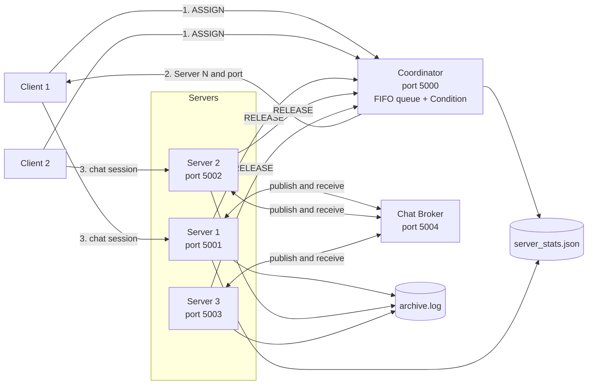
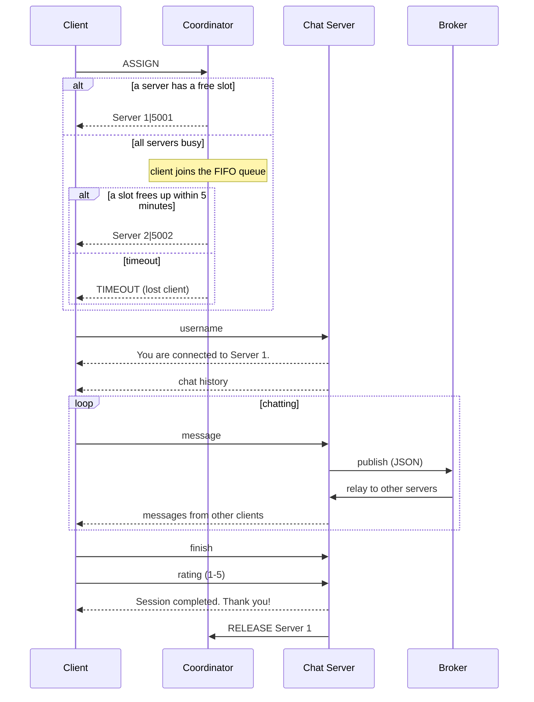

# Chat Server

A multi-server, live group chat system written in Python using raw TCP sockets. Clients are assigned to one of several chat servers by a central coordinator, wait in a FIFO queue when every server is busy, and chat in real time with clients on **all** servers through a shared message broker.

The project compares three ways of serving clients (**iterative**, **threading** and **forking**), records statistics and an archive log, and includes load-testing and performance-monitoring tools.

---

## Table of contents

- [Features](#features)
- [Architecture](#architecture)
- [How a session works](#how-a-session-works)
- [Project structure](#project-structure)
- [Requirements](#requirements)
- [Installation](#installation)
- [Running the project](#running-the-project)
- [Configuration](#configuration)
- [Serving modes](#serving-modes)
- [Communication protocol](#communication-protocol)
- [Statistics and archive logging](#statistics-and-archive-logging)
- [Load testing and performance monitoring](#load-testing-and-performance-monitoring)
- [Assignment requirements mapping](#assignment-requirements-mapping)
- [Known limitations](#known-limitations)
- [Tech stack](#tech-stack)

---

## Features

- **Configurable number of servers**, chosen at startup.
- **Session per client** with a FIFO waiting queue managed by a coordinator.
- **5-minute waiting period.** A client that waits too long receives `TIMEOUT` and is counted as a lost client.
- **Live group chat across servers.** A message sent to one server is delivered to every client on every other server through a broker.
- **Chat history** is replayed to each client when they join.
- **Three serving modes** selectable with one environment variable: iterative, threading, forking (`os.fork()`).
- **Session rating** (1 to 5) collected when the client types `finish`.
- **Server dashboard** printed in the server terminal: name, date and time, clients served today and this month, average rating, clients approached, lost clients and the current client.
- **Statistics** saved to a JSON file, safe across threads and processes.
- **Archive log** written by many threads and processes to one shared file, with a switch to turn it off for comparison.
- **Load testing** with Locust and a **performance monitor** using `psutil`.

---

## Architecture



| Component | File | Role |
|---|---|---|
| Launcher | `main.py` | Asks for the number of servers, then starts the coordinator, broker and servers as separate processes. |
| Coordinator | `coordinator.py` | Listens on port 5000. Assigns clients to servers, keeps the FIFO waiting queue, enforces the 5-minute timeout and tracks active sessions per server. |
| Chat broker | `chat_broker.py` | Listens on port 5004. Relays every chat message from one server connection to all the others. |
| Chat server | `server.py` | Listens on its own port. Handles client sessions in iterative, threading or forking mode, broadcasts messages, collects the rating and writes statistics and logs. |
| Chat history | `chat_manager.py` | Thread-safe list of chat messages. |
| Statistics | `stats_manager.py` | Reads and updates `server_stats.json` using a thread lock plus a file lock. |
| Archive logger | `archive_logger.py` | Appends timestamped events to `archive.log` under an exclusive file lock. |
| Client | `client.py` | Terminal chat client. |
| Load test | `locustfile.py` | Locust user that simulates a full client session. |
| Monitor | `performance_test.py` | Prints CPU, memory and disk I/O counters of the server processes. |
| Archive test | `test_archive.py` | Writes to the archive from 10 threads at once. |

### Ports

| Port | Used by |
|---|---|
| 5000 | Coordinator |
| 5001, 5002, 5003, 5005, 5006, ... | Chat servers (`Server 1`, `Server 2`, ...). Port 5004 is skipped because the broker uses it. |
| 5004 | Chat broker |
| 8089 | Locust web UI (when load testing) |

---

## How a session works



1. The client asks the coordinator for a server (`ASSIGN`).
2. The coordinator gives it a server immediately, or places it in the FIFO queue and waits on a condition variable until a slot frees up or 5 minutes pass.
3. The client connects to the assigned server and sends its username. The server logs the join, prints its dashboard and sends the chat history.
4. Every message is broadcast to local clients, written to the archive log and published to the broker so clients on other servers receive it too.
5. When the client types `finish` and gives a rating, the server saves the session statistics, logs the end of the session and sends `RELEASE` to the coordinator.
6. The coordinator frees the slot and immediately dispatches the next waiting client.

---

## Project structure

```
chat-server/
├── README.md
├── .gitignore
└── src/
    └── chat_server/
        ├── __init__.py
        ├── main.py              # launcher: starts all processes
        ├── coordinator.py       # assignment, FIFO queue, timeout
        ├── chat_broker.py       # cross-server message relay
        ├── server.py            # chat server: iterative / threading / forking
        ├── chat_manager.py      # thread-safe chat history
        ├── stats_manager.py     # JSON statistics with file locking
        ├── archive_logger.py    # shared archive log writer
        ├── client.py            # terminal chat client
        ├── locustfile.py        # Locust load test
        ├── performance_test.py  # psutil performance monitor
        ├── test_archive.py      # concurrent archive-write test
        ├── requirements.txt
        ├── server_stats.json    # generated at runtime
        └── archive.log          # generated at runtime
```

`server_stats.json`, its `.lock` file and `archive.log` are generated at runtime and are listed in `.gitignore`.

---

## Requirements

- **Linux or macOS.** The project uses `fcntl` (file locking), `os.fork()` and `SIGCHLD`, which are not available on Windows. On Windows, use WSL.
- **Python 3.12** (the version the project was developed with).
- Packages listed in `src/chat_server/requirements.txt`.

---

## Installation

```bash
git clone <your-repository-url>
cd chat-server

python3 -m venv .venv
source .venv/bin/activate

pip install -r src/chat_server/requirements.txt
```

`requirements.txt` was produced with `pip freeze`, so it also contains packages installed automatically as dependencies of Locust. The packages the project imports directly are `locust`, `psutil` and `prompt_toolkit`. Everything else used by the code is part of the Python standard library.

---

## Running the project

All modules import each other by plain name, so run every command from the `src/chat_server` directory.

```bash
cd src/chat_server
```

### 1. Start the system

```bash
python main.py
```

Enter the number of servers when prompted:

```
Enter number of servers: 3
```

This starts the coordinator, the broker and the servers. Server dashboards and activity messages are printed in this terminal. Stop everything with `Ctrl+C`.

### 2. Start one or more clients

Open a new terminal for each client:

```bash
cd src/chat_server
source ../../.venv/bin/activate
python client.py
```

```
Enter your username: alice
```

Type messages and press Enter. To end the session, type:

```
finish
```

then enter a rating from 1 to 5.

### Choosing a serving mode

```bash
CHAT_MODE=iterative python main.py
CHAT_MODE=threading python main.py     # default
CHAT_MODE=forking   python main.py
```

---

## Configuration

| Setting | How to change | Default | Meaning |
|---|---|---|---|
| Number of servers | Prompt at startup | none | How many chat servers to start. |
| `CHAT_MODE` | Environment variable | `threading` | `iterative`, `threading` or `forking`. |
| `ARCHIVE_LOGGING` | Environment variable | `1` | Set to `0` to disable archive logging (useful for performance comparison). |
| Waiting period | `wait_timeout` in `coordinator.py` | 5 minutes | How long a client may wait before being marked lost. |
| Slots per server | `capacity` in `coordinator.py` | 3 (1 in iterative mode) | Concurrent sessions the coordinator allows on one server. |

Example:

```bash
ARCHIVE_LOGGING=0 CHAT_MODE=forking python main.py
```

---

## Serving modes

| | Iterative | Threading | Forking |
|---|---|---|---|
| Selected with | `CHAT_MODE=iterative` | `CHAT_MODE=threading` | `CHAT_MODE=forking` |
| Handling in `server.py` | `handle_client()` is called directly inside the accept loop. | A new `threading.Thread` runs `handle_client()` for each client. | `os.fork()` creates a child process for each client. |
| Clients per server at once | 1 (coordinator capacity is 1) | Up to 3 | Up to 3 |
| Memory | One process | Threads share the server process memory | Each child has its own copy of memory |
| Cross-client messages | Through the broker | Through the broker | Through the broker (each child opens its own broker connection) |
| Child cleanup | n/a | Daemon threads | `SIGCHLD` handler calls `os.waitpid(-1, os.WNOHANG)` to reap children |

In forking mode the child restores the chat history it inherited, gets fresh locks and its own broker connection, and leaves with `os._exit(0)`. The parent keeps accepting new clients.

The coordinator itself always uses one thread per incoming connection, regardless of the selected mode.

---

## Communication protocol

All components talk over TCP using newline-terminated text lines.

**Client or server to coordinator (port 5000)**

| Message | Meaning | Reply |
|---|---|---|
| `ASSIGN` | Request a server | `Server N\|port` or `TIMEOUT` |
| `RELEASE Server N` | A session on that server has ended | none |

**Client to chat server**

| Line | Meaning |
|---|---|
| First line | Username |
| Any other line | Chat message |
| `finish`, then a number from 1 to 5 | End the session with a rating |

**Server to broker (port 5004), JSON lines**

```json
{"server": "Server 1"}
{"server": "Server 1", "username": "alice", "message": "hello"}
```

The first line registers the connection. Every following line is a chat message that the broker forwards to all other registered connections except the sender's.

---

## Statistics and archive logging

### `server_stats.json`

Managed by `stats_manager.py`. It stores:

- `totals`: clients approached and lost clients.
- `servers`: per server, daily and monthly counts of clients served and rating sums.
- `sessions`: one record per completed session (client, server, join and leave time, duration, message count, rating).

Updates take a `threading.Lock` and an exclusive `fcntl.flock` on `server_stats.json.lock`, read the file, apply the change, write a temporary file and atomically replace the original. This keeps the file consistent when several threads and processes update it.

### `archive.log`

Managed by `archive_logger.py`. Each event is one timestamped line, for example:

```
2026-10-26 15:49:42 | rocky joined Server A
2026-10-26 15:49:45 | rocky on Server A: hi akka
```

Each write opens the file in append mode, takes an exclusive `flock`, writes and flushes the line, then releases the lock, so lines from many threads and processes do not interleave.

Test it with 10 concurrent threads:

```bash
python test_archive.py
```

---

## Load testing and performance monitoring

### Locust

1. Start the system:

   ```bash
   python main.py
   ```

2. In another terminal, start Locust:

   ```bash
   locust -f locustfile.py
   ```

3. Open <http://localhost:8089>, choose the number of users and the spawn rate, and start the test.

Each simulated user asks the coordinator for a server, connects to it, sends a username and one message, waits 2 seconds, sends `finish` and a rating of `5`, and waits for the confirmation. Locust reports two request types: `Coordinator assignment` and `Chat session`.

To compare modes or the effect of archive logging, repeat the same test with different `CHAT_MODE` and `ARCHIVE_LOGGING` values.

### Performance monitor

With the system running, in another terminal:

```bash
python performance_test.py
```

Every 2 seconds it prints CPU usage, memory (RSS) and disk write counters for each process that is listening on a port of 5001 or higher (except 5004 and 8089). Stop it with `Ctrl+C`.

Note that the disk counters are cumulative per process and include every file the process writes, not only `archive.log`.

---

## Assignment requirements mapping

| # | Requirement | Where it is implemented |
|---|---|---|
| 1 | Limited number of servers | `main.py` (server count), `coordinator.py` (`servers`, `capacity`) |
| 2 | Session for each client | `server.py` `handle_client()`, `coordinator.py` `handle_assignment()` |
| 3 | Waiting period when no server is free | `coordinator.py` waiting queue and `Condition.wait(timeout=...)` |
| 4 | Lost client after the waiting period | `coordinator.py` sends `TIMEOUT` and calls `record_lost()` |
| 5 | Server interface details | `server.py` `print_dashboard()`, `stats_manager.py` `get_dashboard()` |
| 6 | Client interface and rating | `client.py` (date and time, server name, rating prompt) |
| 7 | Load simulation | `locustfile.py` |
| 8 | Iterative, threading and forking | `server.py` `start_server()` |
| 9 | Speed, load and concurrency documentation | `locustfile.py`, `performance_test.py` |
| 10 | Locks and condition variables | `coordinator.py` `Condition`, `chat_manager.py` and `server.py` locks, `fcntl.flock` |
| 11 | Archive log written by many threads | `archive_logger.py` |
| 12 | Disk activity of archive writes | `performance_test.py` I/O counters, `ARCHIVE_LOGGING` toggle |
| 13 | Disk I/O improvement | Atomic locked writes; logging can be toggled for comparison |

---

## Known limitations

These are documented honestly so that you know what to expect when running or extending the project.

- **Slot release depends on the client.** A slot is freed when the session ends. If a client is assigned a server but never connects with a username, the slot is not released automatically.
- **Waiting clients that disconnect** are not detected by the coordinator until it tries to send them an assignment.
- **Statistics rewrite the whole JSON file** on every update, and the `sessions` list grows without limit, so updates get slower as the file grows. The coordinator performs one such update for every `ASSIGN` request.
- **Chat history is unbounded.** Each process keeps all messages in memory and sends the full history to every new client.
- **`approached` and `lost` are global totals**, so every server dashboard shows the same two numbers.
- **The performance monitor** only sees processes that are listening on a port, so forked child processes are not measured, and it may also pick up unrelated programs listening on ports above 5001.
- **Linux and macOS only**, because of `fcntl`, `os.fork()` and `SIGCHLD`.
- `test_archive.py` is a script that runs on import, not a pytest test.

---

## Tech stack

| Tool | Used for |
|---|---|
| Python 3.12 | Language |
| `socket` | TCP communication |
| `threading` | Threads, `Lock`, `Condition`, `Event` |
| `multiprocessing` | Starting the coordinator, broker and server processes |
| `os.fork`, `signal` | Forking mode and child reaping |
| `fcntl` | File locking for statistics and archive log |
| `json`, `pathlib`, `datetime`, `collections.deque` | Data storage, paths, timestamps, FIFO queue |
| `prompt_toolkit` | Client input prompt that does not clash with incoming messages |
| Locust | Load testing |
| `psutil` | CPU, memory and disk I/O monitoring |
