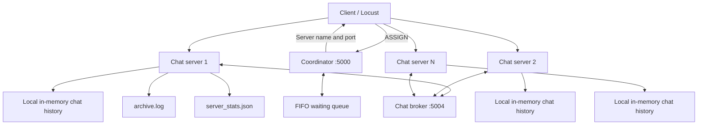

# chat-server

A Python TCP chat-server simulation built to explore client scheduling, concurrency, process management, inter-process messaging, archive logging, and performance under load.

The application routes clients through a coordinator to one of several chat servers. It supports **iterative**, **threading**, and **forking** server modes, and includes a Locust workload and a `psutil`-based performance monitor.

## Features

- TCP communication between clients, the coordinator, chat servers, and a message broker.
- Configurable number of chat servers.
- FIFO waiting queue with a five-minute coordinator timeout.
- Three client-handling modes: iterative, threading, and `os.fork()`.
- Chat-message relay across server processes through a broker.
- In-memory chat history within each server process.
- Client ratings and JSON-based session/server statistics.
- Timestamped archive logging with an environment-variable toggle.
- File locking for coordinated archive and statistics-file access.
- Locust-based load testing and process-level resource monitoring.

## How it works



### Client session

1. The client sends `ASSIGN` to the coordinator at `127.0.0.1:5000`.
2. The coordinator assigns an available server. If no slot is available, the request waits in a FIFO queue.
3. If the coordinator's five-minute wait expires before assignment, it marks the client as lost and responds with `TIMEOUT`.
4. The client connects to the assigned server and sends a username.
5. The server sends a greeting and the chat history available in that server process.
6. The client sends messages. Messages are added to local history, broadcast to local clients, and published to the broker for relay to other servers.
7. The client sends `finish` and a rating from 1 to 5.
8. The server saves session statistics, records the session in the archive, and releases its coordinator slot.

The application uses newline-delimited messages over TCP. TCP is a byte stream, so the newline is the application's message delimiter.

## Server modes

Set `CHAT_MODE` before starting the application.

| Mode | Implementation | Coordinator capacity |
|---|---|---:|
| `iterative` | Handles one client session at a time in the server's accept loop | 1 active client per server |
| `threading` | Starts a thread for each accepted client | 3 active clients per server |
| `forking` | Uses `os.fork()` to handle a client in a child process | 3 active clients per server |

The capacity values are configured in `coordinator.py`. Because the modes do not have the same configured capacity, a fair performance comparison must account for this difference.

Forking uses POSIX process APIs and needs particular care around child-process cleanup, inherited file descriptors, and process-local memory. The broker connection is recreated in the child process. Ordinary Python objects are not automatically shared between forked processes; the broker relays messages between server processes.

## Project structure

```text
chat-server/
├── README.md
└── src/
    └── chat_server/
        ├── main.py
        ├── coordinator.py
        ├── server.py
        ├── client.py
        ├── chat_broker.py
        ├── chat_manager.py
        ├── stats_manager.py
        ├── archive_logger.py
        ├── locustfile.py
        ├── performance_test.py
        ├── test_archive.py
        └── requirements.txt
```

| File | Responsibility |
|---|---|
| `main.py` | Prompts for the server count and starts the coordinator, broker, and server processes. |
| `coordinator.py` | Assigns servers, tracks active slots, manages the FIFO queue and timeout, and accepts slot-release requests. |
| `server.py` | Handles client sessions, local broadcasts, broker communication, session ratings, statistics updates, and archive events. Implements the three server modes. |
| `client.py` | Interactive terminal client for chatting and submitting a rating. |
| `chat_broker.py` | Relays messages between server processes. |
| `chat_manager.py` | Maintains in-memory chat history with a thread lock. |
| `stats_manager.py` | Reads and updates `server_stats.json` with file locking and a temporary-file replacement. |
| `archive_logger.py` | Writes timestamped events to `archive.log` using append mode and an exclusive file lock. |
| `locustfile.py` | Simulates clients and reports assignment and chat-session response times to Locust. |
| `performance_test.py` | Monitors CPU, resident memory, and process-level I/O counters for detected server processes. |
| `test_archive.py` | Exercises concurrent archive logging with 10 threads, each writing 100 entries. |

Runtime files (`archive.log`, `server_stats.json`, and `server_stats.json.lock`) are generated alongside the Python modules and excluded from Git by `.gitignore`.

## Requirements

- Python 3.12 (the version used for this project).
- Linux/POSIX environment recommended. The implementation uses `fcntl.flock()` and `os.fork()`.
- Dependencies listed in `src/chat_server/requirements.txt`.

## Setup

Clone the repository and enter the project directory:

```bash
git clone https://github.com/GeethikaAmiti/chat-server.git
cd chat-server
```

Create and activate a virtual environment, then install the dependencies:

```bash
python3 -m venv .venv
source .venv/bin/activate
pip install -r src/chat_server/requirements.txt
```

## Run the application

Run the commands below from the repository root. The application asks how many chat servers to start.

**Threading mode (default):**

```bash
python src/chat_server/main.py
```

**Iterative mode:**

```bash
CHAT_MODE=iterative python src/chat_server/main.py
```

**Forking mode:**

```bash
CHAT_MODE=forking python src/chat_server/main.py
```

The coordinator listens on `127.0.0.1:5000`. The broker listens on `127.0.0.1:5004`. Chat servers use ports starting at `5001`, skipping `5004` because it belongs to the broker.

To use the interactive client, open another terminal, activate the virtual environment, and run:

```bash
cd src/chat_server
python client.py
```

Enter a username, exchange messages, and type `finish` to end the session and submit a rating.

Stop the application with `Ctrl+C` in the terminal running `main.py`.

## Load testing with Locust

Start the application first. In a second terminal:

```bash
source .venv/bin/activate
cd src/chat_server
locust --web-host 127.0.0.1
```

Open `http://127.0.0.1:8089`, then configure the number of users, spawn rate, and test duration.

The current Locust user:
- Requests a server assignment from the coordinator.
- Connects to the assigned server.
- Sends one chat message.
- Waits two seconds, then sends `finish` and rating `5`.
- Waits for the server's completion confirmation.
- Waits a random 1–2 seconds between task executions.

Locust reports two timings: **Coordinator assignment** and **Chat session**. The script uses `time.perf_counter()` to measure elapsed time in milliseconds.

**Timeout note:** The coordinator's queue timeout is five minutes. The Locust script creates its coordinator socket with a 20-second socket timeout (`WAIT_TIMEOUT + 10`, where `WAIT_TIMEOUT` is 10 seconds). A queued Locust client may therefore hit its socket timeout well before the coordinator's five-minute timeout. Align these settings before interpreting queue-timeout results.

The current Locust script generates client names in memory; it does not load a client workload from a file.

## Performance monitoring

Start the application, then run the monitor in another terminal:

```bash
source .venv/bin/activate
python src/chat_server/performance_test.py
```

The monitor checks listening TCP ports to find server processes and prints CPU usage, resident memory, write-operation count, and bytes written. It refreshes approximately every two seconds. Press `Ctrl+C` to stop.

**Interpreting I/O values:** `psutil` reports process-level I/O counters, not I/O attributable only to `archive.log`. The displayed write counts and byte totals are cumulative counters rather than per-interval deltas. Use before/after deltas under repeatable workloads to compare runs, and do not describe these values as archive-only physical disk writes.

## Archive logging and disk I/O

`archive_logger.py` writes entries to `archive.log` in this format:

```text
YYYY-MM-DD HH:MM:SS | event message
```

The logger:
1. Checks whether archive logging is enabled.
2. Generates a timestamp when `log_event()` is called.
3. Opens the file in append mode.
4. Acquires an exclusive `fcntl.flock()` lock.
5. Writes the entry and calls `flush()`.
6. Releases the lock and closes the file.

This synchronous approach is straightforward and coordinates writes from cooperating processes. Opening and closing the file, locking, and flushing each event can add overhead at high event rates. The timestamp has one-second precision, and the mode is not automatically included in each entry unless the caller includes it in the message.

`flush()` moves Python-buffered output to the operating system; it does not guarantee physical persistence to the storage device.

### Enable or disable archive logging

Logging is enabled by default:

```bash
ARCHIVE_LOGGING=1 CHAT_MODE=threading python src/chat_server/main.py
```

Disable archive logging for a test run:

```bash
ARCHIVE_LOGGING=0 CHAT_MODE=threading python src/chat_server/main.py
```

To estimate logging overhead, run the same workload with logging enabled and disabled. Keep the mode, server count, user count, spawn rate, and test duration consistent; repeat runs and compare throughput, response times, failures, CPU, memory, and I/O observations.

The current implementation is a practical baseline, not a proven optimal method. Buffered or asynchronous logging may reduce overhead in some workloads, but should only be adopted if measurements justify the additional complexity.

## Concurrent archive test

Run the archive exercise from the module directory:

```bash
cd src/chat_server
python test_archive.py
```

The script starts 10 threads, each writing 100 messages through `log_event()`. It prints a completion message when the threads finish. This is a basic concurrent-write exercise, not a comprehensive test of disk durability or multi-process performance.

## Performance comparison checklist

For a fair comparison of iterative, threading, and forking modes:

1. Use the same number of configured servers and the same Locust workload.
2. Record the different active-client capacities (1 per iterative server; 3 per threading/forking server).
3. Use consistent logging settings for the mode comparison.
4. Repeat each run and retain the Locust results.
5. Compare throughput, failure/timeout rate, median and tail latency, CPU, and memory.
6. Run a separate logging-on/logging-off experiment to estimate archive logging overhead.
7. Treat process-level I/O counters as process measurements, not archive-specific physical disk activity.
8. Report what the measurements show; do not assume one mode or logging method is always best.

## Known limitations

- The current load test does not read a client workload from a file.
- Locust's socket timeout and the coordinator's five-minute queue timeout are not aligned.
- Archive timestamps have one-second precision and do not automatically include the server mode.
- Process-level I/O counters do not isolate writes to `archive.log`.
- Forking mode requires validation under load, particularly around child lifecycle and inherited resources.
- Performance results depend on workload, machine, configuration, and repeated-run variability.

## Repository

[GeethikaAmiti/chat-server](https://github.com/GeethikaAmiti/chat-server)
